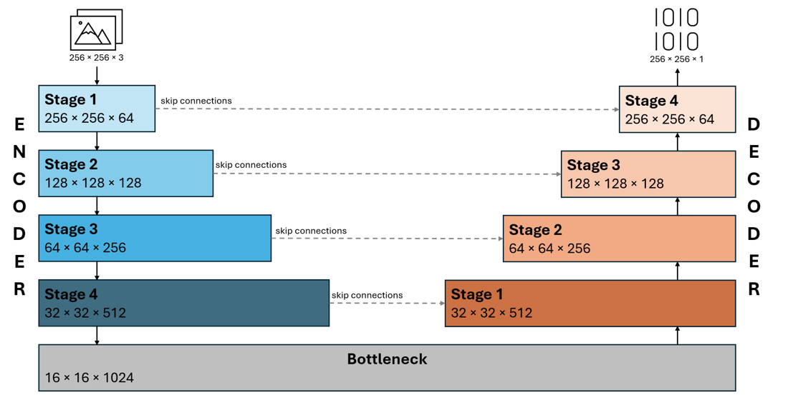
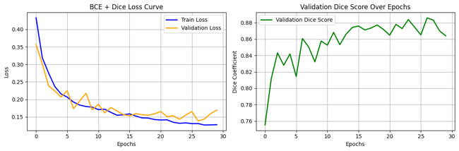
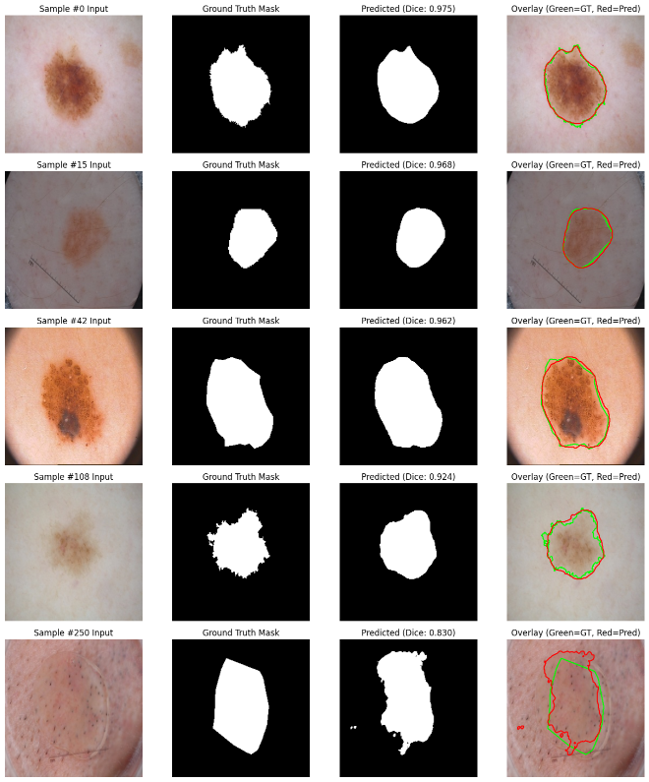

# U-Net Skin Lesion Segmentation (ISIC 2018)

PyTorch implementation of a 4-stage U-Net for dermoscopic skin lesion segmentation on the **ISIC 2018 Task 1** dataset (`2,594` paired training/validation images and `999` unseen test images).

## Files
* `analyze_dataset.ipynb` — Inspects raw image dimensions (`159` unique resolutions), mask encodings, and verifies PyTorch `DataLoader` tensor shapes (`256 × 256`).
* `train_segmentation.ipynb` — Defines the `UNet` and `BCEDiceLoss` modules, runs shape and 5-image overfitting sanity checks, caches resized tensors to disk/RAM, trains with mixed precision (`torch.amp`), evaluates validation metrics, and generates full-resolution test masks.

## Architecture & Pipeline



* **U-Net Backbone:** 4-stage symmetric encoder-decoder (`64 → 128 → 256 → 512 → 1024` bottleneck) using `DoubleConv` blocks (`Conv2d` → `BatchNorm2d` → `ReLU`), `MaxPool2d` downsampling, `ConvTranspose2d` upsampling, and channel-wise skip connections.
* **Hybrid Loss (`BCEDiceLoss`):** Combines `BCEWithLogitsLoss` and soft Dice loss (`bce_weight=0.5`) to handle the `~32:1` background-to-lesion pixel imbalance (`+0.1079` Dice gain over BCE alone).
* **Fast Data Pipeline:** Multi-threaded (`8` workers) `256 × 256` disk caching (`cache_256_img/`, `cache_256_msk/`) followed by pre-allocated RAM loading with a reproducible `80/20` train/validation split (`seed=42`).
* **Test Inference:** Runs AMP inference across `999` official test images, upsamples predicted binary masks (`threshold=0.5`) back to native resolutions (`<ID>_segmentation.png`), and exports a `300 DPI` prediction grid (`isic_test_predictions_grid.png`).

## Setup

1. **Clone & install dependencies**
   ```bash
   git clone https://github.com/Shariq80/unet-skin-lesion-segmentation.git
   cd unet-skin-lesion-segmentation
   pip install torch torchvision numpy opencv-python pillow matplotlib
   ```

2. **Add the dataset**
   Download the **ISIC 2018 Task 1** dataset from the [ISIC Archive](https://www.kaggle.com/datasets/tschandl/isic2018-challenge-task1-data-segmentation) and extract it into a `dataset/` folder in the project root:
   ```text
   dataset/
   ├── ISIC2018_Task1-2_Training_Input/
   ├── ISIC2018_Task1_Training_GroundTruth/
   ├── ISIC2018_Task1-2_Test_Input/
   └── ISIC2018_Task1_Test_Predictions/   # Auto-generated during test inference
   ```

3. **Run**
   * Update `BASE_PATH` in the notebooks to `"./dataset"` if needed.
   * Run `analyze_dataset.ipynb` first to verify data loading, then run `train_segmentation.ipynb` to train, evaluate, and export test predictions.

## Results Summary

### Validation Metrics (`519` Held-Out Images)

| Metric | Mean Score | Std. Deviation | Min – Max Range |
| :--- | :--- | :--- | :--- |
| **Dice Coefficient (F1)** | `0.8733` (Peak: `0.8858`) | `± 0.1283` | `0.7449 – 0.9833` |
| **IoU (Jaccard Index)** | `0.7934` | `± 0.1631` | `0.6303 – 0.9565` |
| **Pixel Accuracy** | `94.85%` (`0.9485`) | `± 0.0296` | `0.9189 – 0.9854` |
| **Sensitivity (Recall)** | `90.10%` (`0.9010`) | `± 0.0367` | `0.8643 – 0.9485` |
| **Specificity** | `96.56%` (`0.9656`) | `± 0.0132` | `0.9524 – 0.9835` |
| **Precision** | `89.89%` (`0.8989`) | `± 0.0283` | `0.8706 – 0.9326` |

### Training Convergence



* **Training Setup:** Adam (`lr=2e-4`), Batch Size `16`, `30` Epochs, `80/20` Split, Mixed Precision (`AMP`).
* **Loss Trajectory:** Training and validation `BCE + Dice` losses converge smoothly from `0.433` / `0.357` down to `0.128` / `0.139` (min), with validation Dice peaking at `0.8858` at Epoch `26`.

### Qualitative Validation Overlays



* **Generalization & Test Inference:** `94.3%` of validation samples achieve a Dice score `≥ 0.80`. Inference across all `999` unseen test images completes in `~159s` (`6.3 img/sec`) with an average predicted lesion coverage of `28.29% ± 19.63%`.
